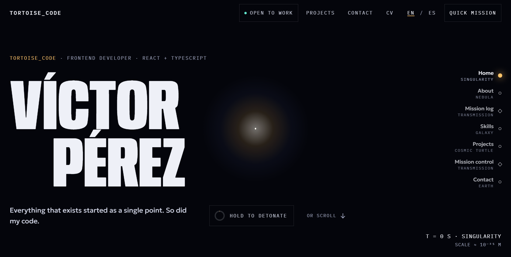
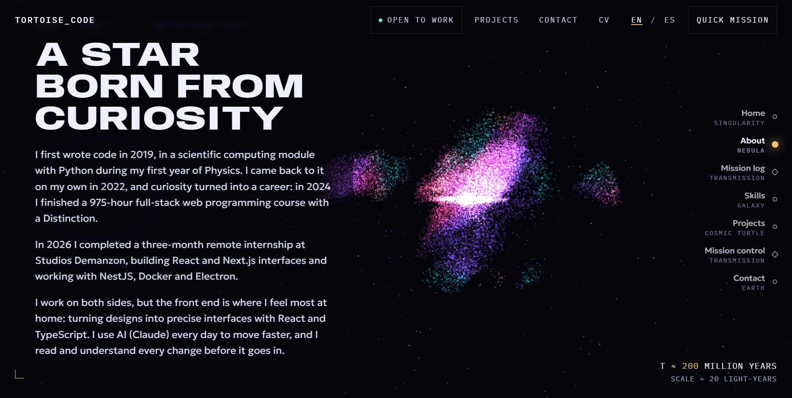
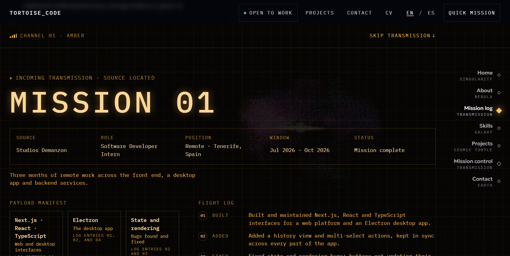
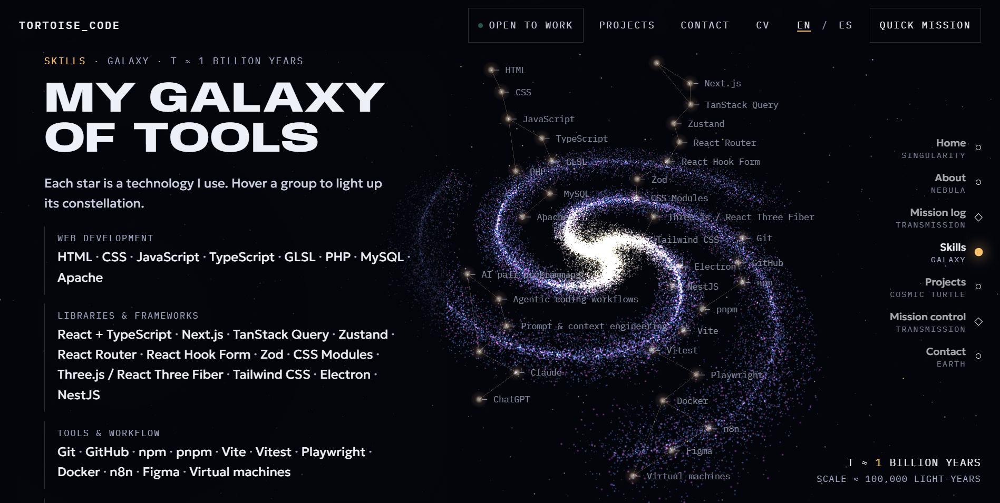
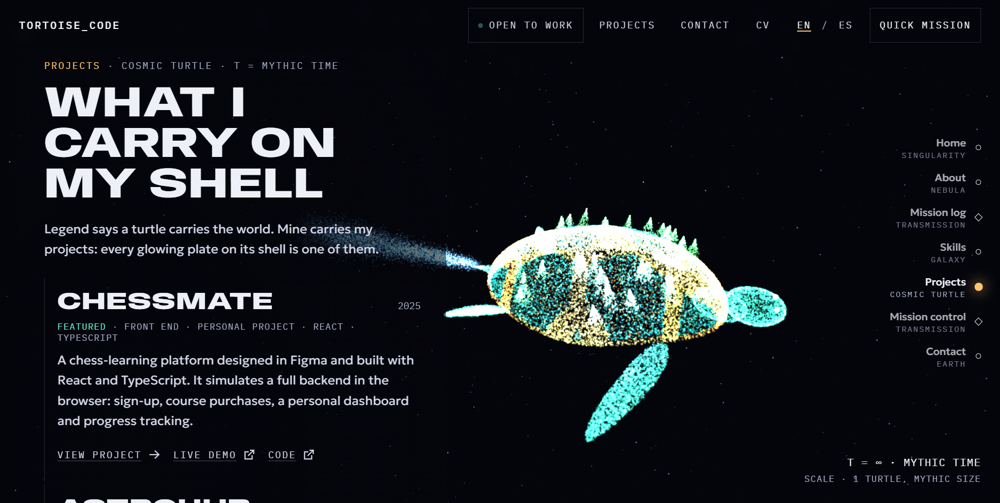
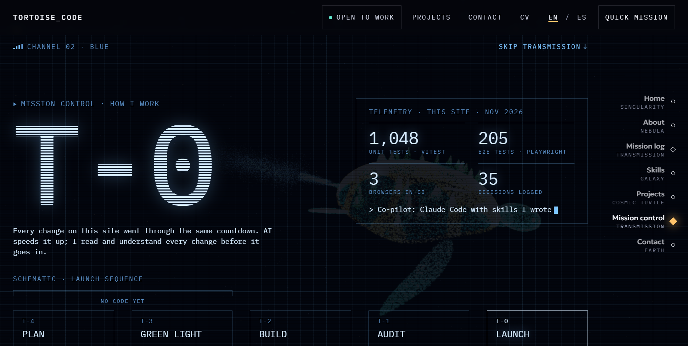
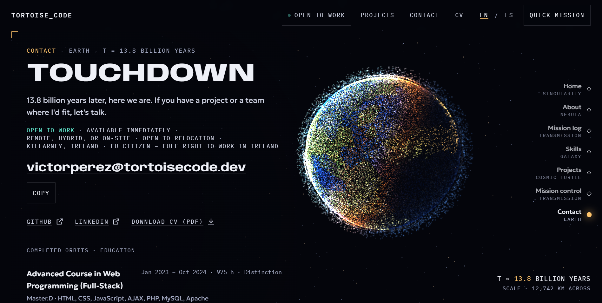
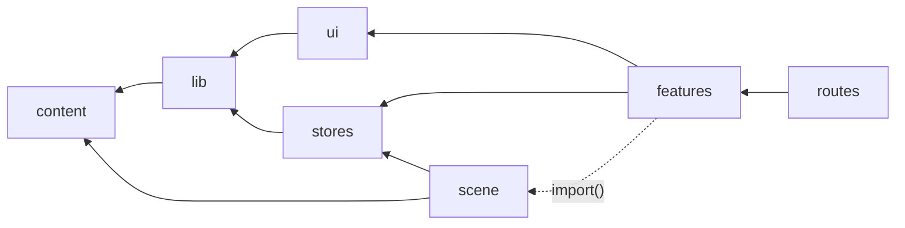

# 🌌 Cosmos: a scroll journey from the Big Bang to Earth

My personal portfolio, built as a story. As you scroll, time moves forward: tens of thousands of particles
morph from a **singularity** into a **nebula**, a **galaxy**, a **cosmic turtle** that carries my projects on its
shell and **Earth**, and in the epilogue they rebuild **my portrait**. Each stage of the universe is a section of
the site.

The goal was a site that is visually striking and still easy to use: all the content lives in the HTML and reads
without WebGL or JavaScript, and a **quick-mission mode** shows everything on one page.

I built it with **React, TypeScript and WebGL (React Three Fiber + my own GLSL shaders)**, using Claude Code as an
AI pair programmer: every step starts with a plan I approve, and I read and understand every change before it
goes in.

**Live:** [tortoisecode.dev](https://tortoisecode.dev)



---

## Table of contents 🧭

- [The journey](#the-journey-)
- [Features](#features-)
- [Challenges and what I learned](#challenges-and-what-i-learned-)
- [Architecture](#architecture-)
- [Quality](#quality-)
- [Installation](#installation-)
- [Project structure](#project-structure-)
- [Tech stack](#tech-stack-)
- [Licence](#licence-)
- [Contact](#contact-)

---

## The journey 🚀

| | |
|---|---|
|  |  |
| **About · Nebula.** Who I am, next to the first cloud of particles. | **Mission log.** An interlude styled as an incoming transmission. |
|  |  |
| **Skills · Galaxy.** Each star is a technology; hover or focus a group to light up its constellation. | **Projects · Cosmic turtle.** Every glowing plate on its shell is one of my projects. |
|  |  |
| **Mission control.** How I work, with figures counted from this repo when the site is built. | **Contact · Earth.** 13.8 billion years later, here we are. |

---

## Features ✨

- **Scroll-driven particle morphing** across six scenes, with a Big Bang you can detonate by holding a button.
- **Skill constellations** that light up with the mouse, the keyboard or touch.
- **Two interludes** styled as incoming transmissions: a mission log and how I work.
- **An epilogue, the Crew file:** the same particles rebuild my portrait from a single photo, as a scanner hologram,
  next to my details and the CV.
- **Bilingual site** (English / Spanish), with a page per project pre-rendered for search engines.
- **Quick-mission mode** with all the content on one page.
- **Works without WebGL and with reduced motion:** without WebGL, still photos of the scene take its place.
- **Three quality levels** picked per device, which step down on the fly if the frame rate drops.

---

## Challenges and what I learned 💡

- **One particle system, many shapes.** Instead of a mesh per scene, a single system of up to 60,000 particles
  morphs between shapes in the vertex shader. The shapes are generated in a Web Worker with a fixed seed, so the
  universe is the same on every visit and the main thread stays free.
- **A 3D site that is still a website.** The scene loads after the first paint, in its own chunk, and the site is
  complete without it: all the content is in the pre-rendered HTML, and the scene is a decorative layer behind it.
- **Performance budgets enforced by tests.** The scene's JavaScript, Three.js included, has to stay within 260 KB
  gzip, and each page's own JavaScript within 40 KB. An end-to-end test measures the real build on every pull
  request.
  It held 60 fps on desktop at the highest level in my measurements.
- **Accessible WebGL.** The constellations are driven from the HTML panel, so they work with the keyboard and a
  screen reader; the scene never hides content and pauses when it isn't needed.
- **Figures that can't go stale.** Mission control shows the number of tests, browsers and decisions in this repo.
  A Vite plugin counts them when the site is built, reading the test files with the TypeScript compiler.
- **Working with AI without losing control.** Every step starts with a plan I approve, and a second AI session
  audits each task with fresh eyes; its fixes ship before the next task. Every decision that shapes the architecture is
  written down as an ADR in [`DECISIONS.md`](./DECISIONS.md).

---

## Architecture 🧱

The code lives in `src/`, split into layers. Each layer has an allow-list of what it may import (for example, `ui`
only imports `lib`, and `content` imports nothing), and **ESLint enforces it**: a forbidden import fails the lint, in
the pre-commit hook and in CI.



_An arrow means "imports". Dashed: loaded on demand._

- **`content`:** typed data (texts in English and Spanish, projects, skills, chapters). No logic.
- **`lib`:** pure helpers (i18n, scroll, SEO, device detection). From `content`, only its types and texts.
- **`stores`:** shared state with Zustand.
- **`ui`:** presentational components that only receive props.
- **`features`:** the pieces of the interface with their own logic (the journey, navigation, project pages).
- **`routes`:** the pages, with React Router in framework mode (static pre-rendering, no server).
- **`scene`:** the 3D scene with React Three Fiber and GLSL shaders. Only one component loads it, with a dynamic
  import, so Three.js never lands in the initial JavaScript.

Scrolling drives a single value, `m`, that both the interface and the scene read. The project and design docs
(in Spanish) are in [`docs/`](./docs/README.md), and every decision is an ADR in [`DECISIONS.md`](./DECISIONS.md).

---

## Quality ✅

Every pull request runs in GitHub Actions:

- **Typecheck, lint and format** (TypeScript strict, ESLint with type-aware rules, Prettier).
- **Unit and component tests** with Vitest and Testing Library, with coverage thresholds.
- **End-to-end tests** with Playwright in **Chromium, Firefox and WebKit**: the full journey, keyboard
  navigation, the site without WebGL or JavaScript, text at 200 %, SEO tags and performance budgets.
- **Visual regression** of every chapter, run in Docker so the screenshots are stable.

Deployed as a static site on Vercel, with a preview per pull request.

---

## Installation 🔧

### Prerequisites

- **Node.js** 24
- **npm**
- **Git**
- **Docker** (only for the visual regression tests and the scene stills)

### Steps

```bash
# Clone the repository
git clone https://github.com/Tortoise-code-Z/Portfolio---Cosmos

# Go into the project folder
cd Portfolio---Cosmos

# Install dependencies
npm ci

# Install the browsers for the end-to-end tests
npx playwright install

# Create your local env file (the public URL of the site)
cp .env.example .env

# Start the development server
npm run dev
```

### Useful scripts

| Script | What it does |
|---|---|
| `npm run dev` | Development server |
| `npm run build` | Static build with every page pre-rendered, in `build/client/` |
| `npm run check` | Typecheck, lint, format check and unit tests |
| `npm run test:coverage` | Unit tests with coverage |
| `npm run e2e` | End-to-end tests in the three browsers, on the build (run `npm run build` first) |
| `npm run visual` | Visual regression in Docker |

---

## Project structure 📁

```plaintext
Portfolio---Cosmos/
│
├── docs/              ← vision, content, experience, design, scene and technical docs (in Spanish)
├── public/            ← static files (CV, favicon)
├── scripts/           ← build-time telemetry, the Docker runners and the portrait pipeline (Python)
├── src/
│   ├── content/       ← typed data: texts, projects, skills, chapters
│   ├── lib/           ← pure helpers
│   ├── stores/        ← Zustand stores
│   ├── ui/            ← presentational components
│   ├── features/      ← journey, navigation, project pages, scene mount
│   ├── scene/         ← React Three Fiber scene, shaders and the shapes worker
│   ├── routes/        ← pages
│   └── root.tsx
├── tests/
│   ├── e2e/           ← Playwright
│   ├── visual/        ← visual regression
│   └── stills/        ← still photos of the scene for the no-WebGL mode
│
├── DECISIONS.md       ← architecture decision records
└── README.md
```

---

## Tech stack 🧰

**Core**

- React + TypeScript
- Three.js + React Three Fiber, with my own GLSL shaders
- React Router (framework mode, static pre-rendering)
- Zustand: global state

**Styling**

- CSS Modules with design tokens
- Responsive design, with reduced motion support

**Tooling**

- Vite: build tool and dev server
- Vitest + Testing Library: unit and component tests
- Playwright: end-to-end and visual regression tests
- ESLint + Prettier
- GitHub Actions: CI
- Vercel: hosting
- Claude Code: AI pair programmer

---

## Licence 🧾

The code is under the [MIT licence](./LICENSE).

---

## Contact 📬

- **Portfolio:** [tortoisecode.dev](https://tortoisecode.dev)
- **Email:** victorperez@tortoisecode.dev
- **LinkedIn:** [linkedin.com/in/víctor-pérez-developer](https://www.linkedin.com/in/v%C3%ADctor-p%C3%A9rez-developer)
- **GitHub:** [github.com/Tortoise-code-Z](https://github.com/Tortoise-code-Z)
